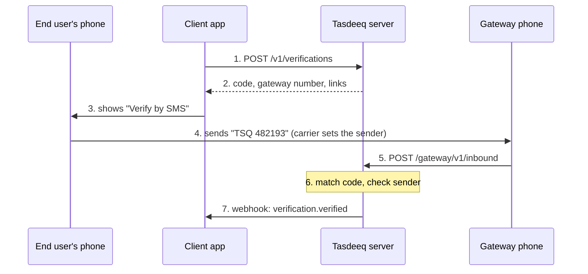
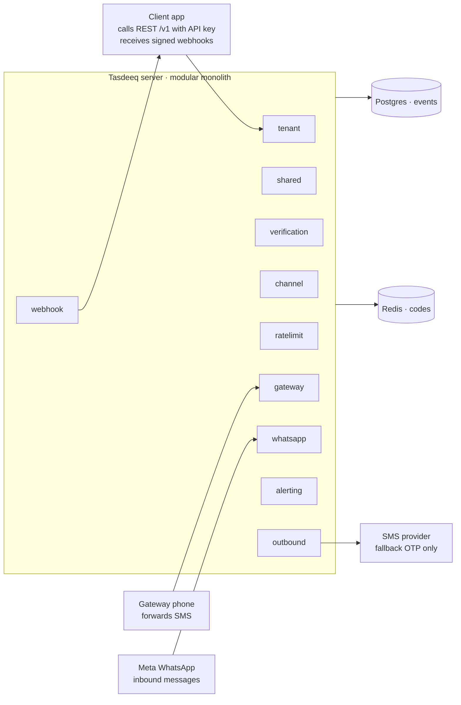

# Tasdeeq — Software Specification

Open-source phone-number verification kit for Pakistani startups · v1.0, final for build · Nov 25, 2026 · Ali Haider

## 1. Overview

Tasdeeq (Urdu for "verification") is a self-hosted, open-source service that proves a person owns a Pakistani mobile number. It does this mainly by having the user send a message to the operator, so the operator pays nothing per verification.

**Problem.** Small Pakistani startups need phone verification for sign-up and light KYC. Outbound SMS OTP through aggregators costs money on every attempt, needs masking or short-code paperwork, and is open to SMS pumping fraud. Most early-stage products cannot justify that.

**Approach.** Tasdeeq inverts the OTP. The service shows the user a code; the user sends it by SMS to a gateway SIM (an Android phone the operator owns) or by WhatsApp to the operator's business number. The carrier or Meta stamps the sender's number, which proves ownership. Outbound SMS OTP through a paid provider remains as a fallback for users who cannot send.

### Goals

1. Verify ownership of a Pakistani mobile number at zero marginal cost for the common case.
2. Run on hardware a solo founder already has: one Android phone with a spare SIM and one small server.
3. Be reusable: any Pakistani startup can clone, configure and deploy it without code changes.
4. Expose one stable REST API so channels can be added or swapped without touching integrating apps.
5. Keep every state change auditable through an event log.

### Non-goals (v1)

- Bulk or marketing SMS, or any outbound messaging beyond the fallback OTP.
- Becoming a PTA-licensed aggregator or connecting to carriers over SMPP.
- Full KYC (CNIC checks, NADRA, biometrics). Tasdeeq answers only "does this person control this number?"
- Countries other than Pakistan, although nothing should hard-block adding them later.
- High-assurance use such as wallets or payments, where proof that the SIM is present at that moment is required on every sensitive action.

## 2. Glossary

| Term | Meaning |
| --- | --- |
| Operator | The startup or developer who deploys and runs a Tasdeeq instance |
| Client app | An application (mobile, web, backend) that calls Tasdeeq's API; one operator can register several |
| End user | The person whose number is being verified |
| Verification | One attempt to prove ownership of one number; has a code, a TTL and a status |
| Reverse OTP | The end user sends the code to the operator, instead of receiving it |
| Channel | A way to complete a verification: `SMS_REVERSE`, `WHATSAPP_REVERSE`, `SMS_OUTBOUND` |
| Gateway device | An Android phone running the Tasdeeq Gateway app with one SIM bound to it |
| Gateway number | The MSISDN of the bound SIM, shown to end users as the number to text |
| Claimed number | The number the end user typed before verifying; optional |
| Sender number | The number the carrier or Meta reports as the message's sender |
| E.164 | International number format, e.g. `+923001234567`; the only format stored |
| TTL | How long a verification code stays valid |
| Fallback provider | A paid outbound SMS API used only for `SMS_OUTBOUND` |

## 3. Actors

| Actor | Wants | Touches |
| --- | --- | --- |
| End user | Verify quickly, with no cost or confusion | Client app UI, their own SMS or WhatsApp app |
| Client app developer | One simple API and a webhook when a number is verified | Public REST API, webhooks |
| Operator / admin | Register client apps, manage gateway devices, see health and audit logs | Admin API, config files, dashboards |
| Gateway device | Forward matching inbound SMS reliably and report its health | Gateway API |
| Fallback provider | Deliver an outbound OTP SMS | Provider adapter (outbound only) |
| Meta WhatsApp Cloud API | Deliver inbound WhatsApp messages | WhatsApp webhook endpoint |

## 4. Verification flows

Every flow starts the same way: the client app creates a verification and receives a code plus instructions for each channel that is enabled. The flows differ only in how the proof arrives.

### 4.1 SMS reverse OTP (primary)

1. The client app calls `POST /v1/verifications` with an optional claimed number.
2. Tasdeeq generates a code (e.g. `482193`), picks a healthy gateway number, and returns the message body `TSQ 482193`, the gateway number, and `sms:` deep links for Android and iOS.
3. The end user taps "Verify by SMS"; their SMS app opens with the number and body prefilled; they press Send.
4. The gateway device receives the SMS on its bound SIM, checks it against the body pattern, and POSTs `{sender, body, receivedAt, deviceMessageId}` to `POST /gateway/v1/inbound`.
5. Tasdeeq normalises the sender, finds the active verification for that code, and checks the sender equals the claimed number (when one was given).
6. On a match the status becomes `VERIFIED`, the verified number is recorded, and a `verification.verified` webhook fires.
7. The client app learns the result from the webhook or by polling `GET /v1/verifications/{id}`.



The only message the end user sends is step 4; everything else is server-to-server, so the operator pays nothing per verification.

### 4.2 WhatsApp reverse OTP

The same as 4.1, except the instruction is a `https://wa.me/<number>?text=TSQ%20482193` link and the message arrives through Meta's webhook at `POST /webhooks/whatsapp`. Tasdeeq never replies on WhatsApp; confirmation is shown in the client app, so no billable service messages are sent.

### 4.3 Outbound SMS OTP (fallback)

1. The client app calls `POST /v1/verifications/{id}/fallback`.
2. Tasdeeq sends `Your <AppName> code is 482193` to the claimed number through the configured fallback provider. A claimed number is required here.
3. The end user types the code; the client app calls `POST /v1/verifications/{id}/check`.
4. A correct code verifies; after 5 wrong attempts the verification becomes `FAILED`.

### 4.4 Unclaimed mode

If no claimed number is sent, the reverse channels still work: the sender number becomes the verified number. This saves the user typing their number and avoids typos. Outbound fallback is unavailable in this mode.

### 4.5 Verification states

| State | Entered when | Terminal |
| --- | --- | --- |
| `PENDING` | Created | No |
| `VERIFIED` | Matching proof received | Yes |
| `EXPIRED` | TTL passed with no proof (default 10 min) | Yes |
| `FAILED` | Max wrong attempts, or sender mismatch limit reached | Yes |
| `CANCELLED` | Client app cancels | Yes |

A message whose code matches but whose sender differs from the claimed number is recorded as a `sender_mismatch` event and does not verify. After 3 mismatches the verification fails.

## 5. Functional requirements

Priority: **M** = must for v1, **S** = should, **C** = could.

| ID | Requirement | Priority |
| --- | --- | --- |
| FR-1 | Create a verification with an optional claimed number, optional channel list, optional `externalRef`, optional locale (`en`, `ur`) and optional `platform` (`android`, `ios`, `web`) | M |
| FR-2 | Generate a numeric code (length configurable, default 6) that is unique among active verifications on the same gateway number | M |
| FR-3 | Return per-channel instructions: target number, message body, all deep links (`sms:`, `smsto:`, `wa.me`), display text in the requested locale, and, when `platform` is given, one ready-to-open `link` for that platform | M |
| FR-4 | Accept inbound SMS from authenticated gateway devices and match them to verifications by code | M |
| FR-5 | Normalise every number (claimed, sender, gateway) to E.164 before comparing or storing | M |
| FR-6 | Verify only when the sender equals the claimed number, or always in unclaimed mode | M |
| FR-7 | Expire verifications after the TTL (default 10 min, configurable) | M |
| FR-8 | Deduplicate inbound messages by `(deviceId, deviceMessageId)` so retries never double-process | M |
| FR-9 | Record every state change and inbound message as an append-only event; derive current status from events | M |
| FR-10 | Send signed webhooks for `verification.verified`, `.expired`, `.failed`, with retries and exponential backoff | M |
| FR-11 | Let client apps poll verification status | M |
| FR-12 | Register gateway devices with a one-time pairing token; issue a long-lived device credential | M |
| FR-13 | Track device heartbeats; mark a device unhealthy after 3 missed beats (default 60 s interval) | M |
| FR-14 | Hand out only healthy gateway numbers; rotate across several by least-recently-used | S |
| FR-15 | Alert the operator (email or Telegram webhook) when a device goes unhealthy or recovers | S |
| FR-16 | Send an outbound OTP through a pluggable fallback provider, and check the typed code (max 5 attempts); the code is never returned by any API | S |
| FR-17 | Accept inbound WhatsApp messages via the Meta Cloud API webhook, validating Meta's signature | S |
| FR-18 | Admin API: create client apps, rotate API keys, list devices and verifications, view a verification's event history | M |
| FR-19 | Rate-limit creation per client app, per claimed number and per caller IP | M |
| FR-20 | Purge message bodies and mask numbers in records older than the retention period (default 30 days) | S |
| FR-21 | A minimal server-rendered admin page showing device health and recent verifications | C |
| FR-22 | `tasdeeq-web-widget`: a browser widget that renders instructions, shows a QR code plus number and code on desktop, offers a Copy fallback, and polls the operator's own status endpoint; it never holds an API key | S |
| FR-23 | Publish verification events through an `EventPublisher` SPI: webhooks by default, plus an optional Kafka publisher to a configurable topic with the same event JSON | S |
| FR-24 | `tasdeeq-client and tasdeeq-spring-boot-starter`: backend libraries on Maven Central: a plain Java 17 client (typed API client, DTOs, webhook signature verification) and a Spring Boot starter that auto-configures it | S |

## 6. System architecture

Tasdeeq is one Spring Boot application built as a domain-driven modular monolith, plus a separate Android gateway app. Modules talk only through published application events and their public API packages, never through each other's internals; Spring Modulith enforces this in a test.



Inside the server, modules exchange application events only; `verification` is the core and the only module that changes a verification's state.

### 6.1 Server modules

| Module | Owns | Publishes / consumes |
| --- | --- | --- |
| `verification` | Verification aggregate, code generation, state machine, event store | Publishes `VerificationCreated`, `VerificationVerified`, `VerificationExpired`, `VerificationFailed`; consumes `InboundProofReceived` |
| `channel` | `VerificationChannel` SPI and the `SMS_REVERSE`, `WHATSAPP_REVERSE`, `SMS_OUTBOUND` implementations; instruction building | Publishes `InboundProofReceived` |
| `gateway` | Device registry, pairing, credentials, heartbeats, gateway number selection, inbound SMS endpoint | Publishes `InboundSmsReceived`, `DeviceUnhealthy`, `DeviceRecovered` |
| `whatsapp` | Meta webhook endpoint, signature check, payload parsing | Publishes `InboundWhatsAppReceived` |
| `outbound` | `OutboundSmsProvider` SPI and adapters (a logging stub plus one real provider) | Consumes fallback requests |
| `webhook` | EventPublisher SPI; webhook publisher (subscriptions, HMAC signing, retry, delivery log) and optional Kafka publisher | Consumes verification terminal events |
| `tenant` | Client apps, API keys, per-app config overrides | Read by the others through its API |
| `ratelimit` | Redis token buckets | Called synchronously |
| `alerting` | `AlertSink` SPI: email, Telegram | Consumes device health events |
| `shared` | Phone normalisation, clock, IDs, error model | Library only |

### 6.2 Tech stack

| Concern | Choice |
| --- | --- |
| Language / runtime | Java 21 (server, simulator); Java 17 baseline for the client libraries, so integrators on 17 can use them; Kotlin (gateway app) |
| Framework | Spring Boot 3.x, Spring Modulith, Spring Security, Spring Web MVC |
| Database | PostgreSQL 16, Flyway migrations, Spring Data JPA (Hibernate) |
| Cache, locks, rate limits | Redis 7 |
| Optional event streaming | spring-kafka, active only when `tasdeeq.events.kafka.*` is set |
| Phone numbers | Google libphonenumber |
| API docs | springdoc-openapi; the OpenAPI file is committed and contract-tested |
| Admin page | Thymeleaf, server-rendered, no separate front-end build |
| Build | Maven (server, simulator, client libraries); Gradle (Android); npm (web widget) |
| Tests | JUnit 5, Mockito, Testcontainers, Cucumber for BDD flows, ArchUnit / Modulith verification |
| Android app | Kotlin, minSdk 26, Jetpack (WorkManager, Room, DataStore), OkHttp, Hilt |
| Web widget | Plain TypeScript, no framework, under 15 KB gzipped, published to npm and as a single script file |
| Packaging | Docker image and `docker-compose.yml` (server, Postgres, Redis, Caddy for TLS) |
| CI | GitHub Actions with path filters: verify on every PR; release images to GHCR, the APK to GitHub Releases, the client libraries to Maven Central with their jars also on GitHub Releases, the widget to npm; all from one git tag |

### 6.3 Repository layout

One monorepo. The parts are separate applications with separate builds, kept together because they share one API contract and are released as one version.

```
tasdeeq/
├── CLAUDE.md
├── docs/SPEC.md, docs/runbook.md, docs/integration-guide.md, docs/adr/
├── openapi.yaml                   # contract shared by every part
├── pom.xml                        # Maven parent for the Java modules
├── tasdeeq-server/                # Spring Boot service (Maven, not published)
├── tasdeeq-sim/                   # gateway simulator CLI for tests (Maven, not published)
├── tasdeeq-client/                # plain Java client source (published to Maven Central)
├── tasdeeq-spring-boot-starter/   # auto-configuration source (published to Maven Central)
├── tasdeeq-gateway-android/       # Kotlin gateway app (Gradle, own wrapper)
├── tasdeeq-web-widget/            # browser widget (npm)
├── examples/spring-boot-integration/  # sample startup backend using the starter
├── docker-compose.yml
└── .github/workflows/
```

Folders hold source only. Built jars, images and the APK are build outputs: never committed, always produced by the release workflow.

The Android project is not a Maven module; it has its own Gradle wrapper and is opened on its own in Android Studio.

## 7. Data model

PostgreSQL holds durable state; the `verification_event` table is the source of truth for verification status, and `verification` is a projection rebuilt from it. All IDs are ULIDs with a type prefix (`ver_`, `app_`, `dev_`, `evt_`). All timestamps are `timestamptz` in UTC.

### 7.1 Tables

| Table | Key columns |
| --- | --- |
| `client_app` | `id`, `name`, `display_name`, `status`, `config_json` (overrides), `created_at` |
| `api_key` | `id`, `client_app_id`, `prefix` (first 8 chars, shown), `hash` (SHA-256), `scopes`, `last_used_at`, `revoked_at` |
| `gateway_device` | `id`, `label`, `gateway_number` (E.164), `credential_hash`, `app_version`, `android_version`, `last_heartbeat_at`, `health`, `paired_at`, `revoked_at` |
| `verification` | `id`, `client_app_id`, `claimed_number`, `verified_number`, `code_enc`, `status`, `channel_verified_by`, `gateway_device_id`, `external_ref`, `locale`, `expires_at`, `created_at`, `version` |
| `verification_event` | `id`, `verification_id`, `seq`, `type`, `payload_json`, `occurred_at`; unique `(verification_id, seq)` |
| `inbound_message` | `id`, `channel`, `source_device_id`, `source_message_id`, `sender_number`, `body`, `received_at`, `matched_verification_id`; unique `(source_device_id, source_message_id)` |
| `outbound_message` | `id`, `verification_id`, `provider`, `provider_message_id`, `to_number`, `status`, `cost_minor_units`, `sent_at` |
| `webhook_endpoint` | `id`, `client_app_id`, `url`, `secret_hash`, `events`, `active` |
| `webhook_delivery` | `id`, `endpoint_id`, `event_id`, `attempt`, `response_code`, `next_attempt_at`, `status` |

### 7.2 Event types

`created`, `instructions_issued`, `proof_received`, `sender_mismatch`, `code_check_failed`, `fallback_sent`, `verified`, `expired`, `failed`, `cancelled`. Each payload carries what changed and the actor (client app, device, system).

### 7.3 Redis keys

| Key | Value | TTL |
| --- | --- | --- |
| `tsq:code:{gatewayNumber}:{code}` | verification ID | Verification TTL |
| `tsq:lock:ver:{id}` | lock token | 5 s |
| `tsq:rl:{scope}:{key}` | token bucket | Bucket window |
| `tsq:dev:hb:{deviceId}` | last heartbeat epoch | 3 × heartbeat interval |
| `tsq:dedup:{deviceId}:{msgId}` | 1 | 24 h |

Postgres stores the code encrypted (`code_enc`, AES-GCM, key from `TSQ_CODE_KEY`), because the fallback code is a secret. Redis holds the plain code only for matching. If Redis is lost, the code index is rebuilt from `PENDING` verifications on startup.

## 8. API specification

All APIs are JSON over HTTPS, versioned in the path. The committed `openapi.yaml` is the contract; this section is its summary.

### 8.1 Authentication

| Surface | Prefix | Auth |
| --- | --- | --- |
| Public | `/v1` | `Authorization: Bearer tsq_live_…` client app API key; called from the client app's backend only |
| Gateway | `/gateway/v1` | `Authorization: Device <credential>` issued at pairing |
| Admin | `/admin/v1` | Admin API key from `TSQ_ADMIN_KEY`, or OIDC when configured |
| WhatsApp | `/webhooks/whatsapp` | Meta `X-Hub-Signature-256` check, plus the verify-token handshake on `GET` |

### 8.2 Public endpoints

| Method and path | Purpose |
| --- | --- |
| `POST /v1/verifications` | Create a verification (FR-1) |
| `GET /v1/verifications/{id}` | Current status and verified number |
| `POST /v1/verifications/{id}/fallback` | Send an outbound OTP (FR-16) |
| `POST /v1/verifications/{id}/check` | Check a typed fallback code |
| `POST /v1/verifications/{id}/cancel` | Cancel |

Create request and response:

```json
POST /v1/verifications
{ "claimedNumber": "03001234567", "channels": ["SMS_REVERSE", "WHATSAPP_REVERSE"],
  "externalRef": "user_8812", "locale": "ur", "platform": "android" }

201 Created
{ "id": "ver_01JD7K…", "status": "PENDING", "expiresAt": "2026-11-25T10:20:00Z",
  "claimedNumber": "+923001234567", "externalRef": "user_8812",
  "instructions": [
    { "channel": "SMS_REVERSE", "to": "+923217654321", "body": "TSQ 482193",
      "link": "smsto:+923217654321?body=TSQ%20482193",
      "links": { "android": "smsto:+923217654321?body=TSQ%20482193",
                 "ios": "sms:+923217654321&body=TSQ%20482193",
                 "web": "sms:+923217654321?body=TSQ%20482193" },
      "displayText": "…" },
    { "channel": "WHATSAPP_REVERSE", "to": "+923111111111", "body": "TSQ 482193",
      "link": "https://wa.me/923111111111?text=TSQ%20482193",
      "links": { "universal": "https://wa.me/923111111111?text=TSQ%20482193" },
      "displayText": "…" } ] }
```

`link` appears only when `platform` was sent; it is the one URL that client should open, with each platform's quirks already applied (iOS `&body=`, Android `?body=`, URL-encoding). `links` always carries every variant, so a client that serves several platforms can choose itself. Clients open the link with the platform's standard open-URL call; they never build links. On Android, clients should also pass `body` as the `sms_body` intent extra, because some SMS apps ignore the URI body.

The instructions say only which channels are available right now: a channel with no healthy gateway or no WhatsApp config is left out. `Idempotency-Key` headers are honoured on every `POST` for 24 h.

### 8.3 Gateway endpoints

| Method and path | Purpose |
| --- | --- |
| `POST /gateway/v1/pair` | Exchange a one-time pairing token for a device credential |
| `POST /gateway/v1/inbound` | Forward one or more inbound SMS (batch of up to 50) |
| `POST /gateway/v1/heartbeat` | Report liveness, battery, signal, app version, queue depth |

Delivery between phone and server is an outbox on the phone and an inbox on the server: at-least-once delivery with idempotent receipt.

```json
POST /gateway/v1/inbound
{ "messages": [
  { "deviceMessageId": "a1f…", "sender": "+923001234567", "body": "TSQ 482193",
    "receivedAt": "…", "subscriptionId": 2 },
  { "deviceMessageId": "b7c…", "sender": "+923331112222", "body": "TSQ 77",
    "receivedAt": "…", "subscriptionId": 2 } ] }

200 OK
{ "results": [
  { "deviceMessageId": "a1f…", "status": "ACCEPTED" },
  { "deviceMessageId": "b7c…", "status": "REJECTED", "reason": "invalid_body" } ] }
```

| Status | Meaning | Phone action |
| --- | --- | --- |
| `ACCEPTED` | Row committed to `inbound_message`, whether or not a code matches | Delete from queue |
| `DUPLICATE` | `(deviceId, deviceMessageId)` already stored | Delete from queue |
| `REJECTED` | Permanently invalid (malformed body, sender not a `+92` mobile number) | Delete; count it, never retry |
| no response, timeout, 5xx | Unknown | Keep all items; retry with exponential backoff |

Server rules:

1. The `deviceMessageId` is a UUID the phone creates when the SMS arrives; the phone saves the message to Room before any network call, and the `SmsReceiver` never calls the API itself.
2. The server responds only after the `inbound_message` row commits. The unique key on `(source_device_id, source_message_id)` turns repeats into `DUPLICATE`.
3. Code matching does not happen in the request. The same transaction publishes `InboundSmsReceived` through Spring Modulith's event publication registry, and `verification` matches the code after commit. Unfinished events are re-delivered on restart, so the acknowledgement stays fast and matching retries on its own.
4. A batch holds at most 50 messages; each item is processed and answered independently.

### 8.4 Admin endpoints

`POST/GET /admin/v1/apps`, `POST /admin/v1/apps/{id}/keys`, `DELETE /admin/v1/keys/{id}`, `POST /admin/v1/devices/pairing-tokens`, `GET /admin/v1/devices`, `DELETE /admin/v1/devices/{id}`, `GET /admin/v1/verifications?status=&from=&to=`, `GET /admin/v1/verifications/{id}/events`, `POST/GET /admin/v1/apps/{id}/webhooks`.

### 8.5 Outbound webhooks

Tasdeeq POSTs `{ "id": "evt_…", "type": "verification.verified", "createdAt": "…", "data": { "verificationId": "…", "verifiedNumber": "+92…", "channel": "SMS_REVERSE", "externalRef": "user_8812" } }` with headers `Tasdeeq-Signature: t=<unix>,v1=<hex HMAC-SHA256 of "t.body">`. Receivers reject signatures older than 5 minutes. Retries back off at 1 min, 5 min, 30 min, 2 h, 12 h, then give up and mark the delivery `DEAD`.

### 8.6 Errors

Errors use RFC 9457 problem details with a stable `code`:

| HTTP | `code` | When |
| --- | --- | --- |
| 400 | `invalid_number` | Not a valid Pakistani mobile number |
| 409 | `verification_not_pending` | Action on a terminal verification |
| 422 | `claimed_number_required` | Fallback requested in unclaimed mode |
| 422 | `wrong_code` | Fallback code mismatch (`attemptsLeft` included) |
| 429 | `rate_limited` | Bucket empty (`Retry-After` set) |
| 503 | `no_channel_available` | No healthy gateway, no WhatsApp and no fallback provider |

### 8.7 Integration guide for client apps

A startup integrates Tasdeeq as an external HTTP service it hosts itself: one outbound call to start a verification, and one webhook endpoint (or polling) for the result. Its mobile app and web pages never talk to Tasdeeq.

1. **One-time setup.** The operator creates a client app and API key with the admin API, and registers a webhook URL and secret for that app.
2. **Start.** The user submits their number to the startup's backend. The backend calls `POST /v1/verifications` with `externalRef` set to its own user ID and `platform` set to the client's platform, stores the returned `id` against the user as `PENDING`, and returns `instructions` to the client unchanged.
3. **Show.** The client renders the instructions, with `tasdeeq-web-widget` or its own UI, and opens `link` when the user taps a button. While waiting, it polls the startup's own status endpoint every 2–3 s.
4. **Receive the result.** Tasdeeq sends `verification.verified` to the webhook (or Kafka topic). The backend checks the signature and timestamp, ignores event IDs it has already processed, matches `externalRef` and `verifiedNumber` to the user, and only then marks the phone verified in its own database. As a backup, the backend can call `GET /v1/verifications/{id}` at any time.
5. **Fallback.** If the user cannot send, the backend calls `/fallback`, the user types the received code, and the backend forwards it to `/check`.

**Rules for integrators.** Trust only data the backend received from Tasdeeq (a signed webhook, a Kafka event, or its own authenticated `GET`), never a client saying "verified". Keep the API key and webhook secret on the server. Treat webhook delivery as at-least-once.

**Kafka option.** Operators already running Kafka set `tasdeeq.events.kafka.bootstrap-servers` and `tasdeeq.events.kafka.topic` (default `tasdeeq.verification.events`). Events have the same JSON as webhooks, are keyed by `verificationId`, and are delivered at least once. Webhooks and Kafka can run together.

**Java client libraries.** Two artifacts on Maven Central under group `com.intellermatrix`, both built for Java 17. `tasdeeq-client` is plain Java with no Spring dependency (JDK `HttpClient` and Jackson): `TasdeeqClient` (`createVerification`, `getVerification`, `requestFallback`, `checkCode`, `cancel`), typed DTOs, `TasdeeqWebhookVerifier`, and `TasdeeqApiException` mapping the error codes. `tasdeeq-spring-boot-starter` adds auto-configuration: `TasdeeqClient` and verifier beans configured from `tasdeeq.client.base-url`, `tasdeeq.client.api-key` and `tasdeeq.client.webhook-secret`. Spring Boot users add only the starter:

```xml
<dependency>
  <groupId>com.intellermatrix</groupId>
  <artifactId>tasdeeq-spring-boot-starter</artifactId>
  <version>1.0.0</version>
</dependency>
```

For teams that cannot reach Maven Central, every GitHub Release also carries the jars, sources jars and SHA-256 checksums. The repo ships `examples/spring-boot-integration`, a sample startup backend that uses the starter end to end. Clients for other languages can be generated from `openapi.yaml`.

`docs/integration-guide.md` in the repo repeats this section with copy-paste code for Spring Boot, Node.js, Android (Kotlin), iOS (Swift) and Flutter.

## 9. Android gateway app

The gateway app turns any Android 8+ phone into a receive-only SMS gateway for one SIM. It never sends SMS, and it never forwards a message that does not match the configured pattern. The reference device is a Pixel with a spare SIM in slot 2.

### 9.1 Setup

1. The operator installs the APK via `adb install` or Android Studio. It is not published on Play Store.
2. The app asks for `RECEIVE_SMS`, `READ_PHONE_STATE` (to list SIMs), notification permission, and exemption from battery optimisation. If Android shows "Restricted setting", the setup screen explains App info → ⋮ → Allow restricted settings.
3. The operator scans a pairing QR from the admin page (server URL + one-time token). The app calls `/gateway/v1/pair` and stores the credential in EncryptedSharedPreferences.
4. The operator picks the SIM to bind from the list of active subscriptions and confirms its number (Android does not always report it, so it is entered or confirmed by hand).

### 9.2 Runtime behaviour

| Component | Behaviour |
| --- | --- |
| `SmsReceiver` (manifest-registered for `SMS_RECEIVED`) | Reads PDUs and joins multipart messages; drops the message unless its `subscription` extra equals the bound SIM and its body matches the pattern (default `^TSQ\s?\d{4,8}$`, case-insensitive, trimmed); otherwise saves it to the Room queue. Never aborts the broadcast, so messages still show in the Messages app |
| `ForwardWorker` (WorkManager, expedited) | Sends queued messages in batches to `/gateway/v1/inbound`; deletes only messages the server acknowledged; exponential backoff on failure |
| `HeartbeatService` (foreground service, persistent notification) | Posts a heartbeat every 60 s with battery %, charging state, network type, signal level, queue depth, app version |
| Status screen | Shows paired server, bound SIM and number, last heartbeat and forward results, queue depth, today's forwarded count |
| Boot receiver | Restarts the service after reboot |

### 9.3 Rules

- Messages that do not match are never stored, logged or sent anywhere.
- The queue keeps at most 1,000 items and 24 h of history. Anything older is dropped, because its verification has expired anyway.
- The pattern, heartbeat interval and server URL come from the server at pairing and on each heartbeat response, so operators never rebuild the APK.
- Several devices can be paired; each is independent.

## 10. Security and privacy

The reverse flows rest on one fact: the carrier or Meta sets the sender number, not the user. Everything below protects that fact and limits what Tasdeeq holds.

| Threat | Control |
| --- | --- |
| Someone sends another person's code from their own phone | Sender must equal the claimed number (FR-6); in unclaimed mode the sender *is* the result, so this is not an attack |
| Code guessing on the fallback | 6-digit code, 5 attempts, then `FAILED`; rate limits per number and IP |
| Spoofed sender via international gray routes | Rare on local routes; accept only `+92` mobile senders; flag `sender_mismatch` spikes; document that Tasdeeq suits low-to-medium assurance |
| Forged inbound calls to the gateway API | Device credential (random 256-bit, stored hashed); TLS only; optional mTLS later |
| Forged WhatsApp webhooks | Verify `X-Hub-Signature-256` with the app secret before parsing |
| Replayed inbound messages | Dedup on `(deviceId, deviceMessageId)`; a code is single-use |
| Leaked API key | Keys stored as SHA-256; shown once; prefix for identification; rotate without downtime (two active keys) |
| Webhook tampering | HMAC-SHA256 signature with timestamp, 5 min tolerance |
| SMS pumping | No outbound SMS except the fallback, which requires a claimed `+92` number and per-number limits (default 3 per hour, 10 per day) |
| Lost or stolen gateway phone | Admin revokes the device; credential is useless after that; the phone holds no other secrets |

**Privacy.** The gateway forwards only messages that match the pattern. Logs mask numbers (`+92300****567`) and never print bodies or codes. Message bodies and full sender numbers older than 30 days are purged; aggregates remain. Operators remain responsible for their own privacy notice and for complying with Pakistan's data protection rules as they stand when they deploy.

**Assurance level.** WhatsApp proves control of a WhatsApp account, which may outlive the SIM. Operators that need proof the SIM is present should restrict channels to `SMS_REVERSE` for that step.

## 11. Non-functional requirements

Targets are for a single node (2 vCPU, 4 GB RAM) with one gateway device.

| ID | Requirement | Target |
| --- | --- | --- |
| NFR-1 | API latency, excluding fallback provider calls | p95 under 200 ms |
| NFR-2 | Time from SMS arriving on the gateway to `VERIFIED` | p95 under 5 s with network up |
| NFR-3 | Throughput | 50 verifications per minute sustained |
| NFR-4 | Gateway outage detection | Within 3 heartbeat intervals (3 min by default) |
| NFR-5 | No inbound message lost while the phone is offline | Queued up to 24 h and forwarded on reconnect |
| NFR-6 | Restart safety | Server restart or Redis flush loses no pending verification |
| NFR-7 | Observability | Actuator health, Prometheus metrics (verifications by channel and outcome, device health, webhook failures), structured JSON logs with a correlation ID |
| NFR-8 | Setup time for a new operator | Under 30 minutes from clone to first verified number, following the README |
| NFR-9 | Test coverage | 80% line coverage on `verification`, `channel` and `gateway` modules; every FR covered by at least one test |
| NFR-10 | Localisation | All user-facing text in English and Urdu, selected by `locale` |

## 12. Reusability

Another startup should be able to run Tasdeeq by editing one `.env` file and pairing a phone. Nothing about one operator's brand, provider or numbers may be hard-coded.

### 12.1 Configuration

All settings live under `tasdeeq.*` in `application.yml`, overridable by environment variables, and per client app through `client_app.config_json`.

| Setting | Default | Notes |
| --- | --- | --- |
| `tasdeeq.code.length` | 6 | 4–8 |
| `tasdeeq.code.prefix` | `TSQ` | The word before the code in the message body; operators can brand it |
| `tasdeeq.verification.ttl` | `PT10M` | ISO-8601 duration |
| `tasdeeq.channels.enabled` | `SMS_REVERSE` | Comma list; WhatsApp and fallback switch on when configured |
| `tasdeeq.gateway.heartbeat-interval` | `PT60S` | Pushed to devices |
| `tasdeeq.whatsapp.*` | unset | Phone number ID, business number, app secret, verify token |
| `tasdeeq.outbound.provider` | `logging` | `logging` (dev stub) or a real adapter name |
| `tasdeeq.events.publishers` | `webhook` | Comma list: `webhook`, `kafka` |
| `tasdeeq.events.kafka.*` | unset | `bootstrap-servers`, `topic` (default `tasdeeq.verification.events`), security settings |
| `tasdeeq.retention.messages` | `P30D` | Purge window |
| `tasdeeq.alerts.*` | unset | SMTP settings or Telegram bot token and chat ID |
| `tasdeeq.i18n.overrides-path` | unset | Folder of message bundles to replace the default English and Urdu text |

### 12.2 Extension points

| SPI | Implement to |
| --- | --- |
| `VerificationChannel` | Add a channel (e.g. missed-call verification) |
| `OutboundSmsProvider` | Connect any Pakistani or international SMS provider |
| `EventPublisher` | Deliver verification events another way (webhook and Kafka ship built in; e.g. RabbitMQ, AWS SNS) |
| `AlertSink` | Send alerts to Slack, Discord, etc. |
| `NumberPolicy` | Change which numbers are accepted (e.g. allow other countries) |

Adapters are discovered as Spring beans and selected by name in config. Each SPI ships with a contract test kit that a new adapter must pass.

### 12.3 Tenancy

One instance serves many client apps belonging to the same operator; each has its own keys, webhooks and config overrides. Running Tasdeeq as a shared service for unrelated companies is out of scope for v1. Each company should run its own instance, which also keeps their users' numbers separate.

### 12.4 Distribution and licence

Apache-2.0. One git tag releases everything under one version number (server `1.2.0` ships with client `1.2.0`): the server Docker image to GHCR, the gateway APK to GitHub Releases, `com.intellermatrix:tasdeeq-client` and `com.intellermatrix:tasdeeq-spring-boot-starter` to Maven Central (signed, with sources and Javadoc jars, also attached to the GitHub Release), `tasdeeq-web-widget` to npm, plus `openapi.yaml`, a Postman collection and a README with a 30-minute quick start. Built artifacts are never committed to the repo. Releases follow semantic versioning; the public and gateway APIs, the event JSON and the client libraries keep backward compatibility within a major version.

## 13. Pakistan-specific considerations

**Number formats.** Users write numbers many ways. Accept `03001234567`, `3001234567`, `923001234567`, `+923001234567`, `00923001234567`, with spaces or dashes, and store only E.164 (`+923001234567`). Use libphonenumber with region `PK` and accept only the `MOBILE` type.

**Carriers.** Never infer the carrier from the prefix. Mobile number portability means a `0300` number can be on any network. Tasdeeq does not need the carrier at all.

**Regulation.** The reverse channels only receive messages, so the operator sends no bulk or A2P SMS from SIMs. The outbound fallback must go through a provider that holds the required PTA authorisation for A2P SMS; Tasdeeq never sends outbound messages from the gateway SIM. Operators should check current PTA rules before launch. This document is not legal advice.

**SIM upkeep.** Prepaid SIMs can be deactivated after a long period with no chargeable activity, and receiving SMS may not count. The admin page should show a reminder; operators should top up or send one paid SMS every month or two.

**End user cost and access.** Sending the reverse SMS costs the user one standard SMS or a unit of their bundle. Users with no balance can use WhatsApp (needs data or WiFi) or the fallback. Instructions should say this plainly in Urdu and English.

**WhatsApp pricing.** Inbound messages are free. Meta started charging for service replies on 1 October 2026, with a monthly free allowance per number. Tasdeeq therefore never replies on WhatsApp.

**Operator's Meta account.** The WhatsApp channel needs a Meta Business account and a developer app. If the operator's account is restricted, they can launch with SMS reverse plus fallback and enable WhatsApp later.

## 14. Testing strategy

Work test-first: each requirement gets a failing test before its code. The full flow must be testable without a real phone, so a simulated gateway is part of the product.

| Layer | What | Tools |
| --- | --- | --- |
| Unit | Code generation, phone normalisation (table of 30+ formats), state machine transitions, HMAC signing, pattern matching | JUnit 5, Mockito, AssertJ |
| Module | Each module in isolation with its events | Spring Modulith `@ApplicationModuleTest`, `Scenario` API |
| Architecture | No module reaches into another's internals | `ApplicationModules.verify()`, ArchUnit |
| Integration | Real Postgres and Redis; Redis flush recovery; dedup under concurrent inbound calls | Testcontainers |
| BDD | One feature file per flow in section 4, in business language | Cucumber |
| Contract | Implementation matches `openapi.yaml`; each SPI adapter passes its contract kit | Spring Cloud Contract or Schemathesis |
| Simulator | `tasdeeq-sim` CLI acts as a gateway device: pairs, heartbeats, sends inbound SMS on command | Java CLI in the repo |
| Android | Receiver filtering (wrong SIM, wrong pattern, multipart), queue retry, WorkManager | Robolectric, instrumented tests; emulator SMS via `adb emu sms send <number> <body>` |
| End to end | Server in Docker plus emulator plus simulator, run in CI nightly | GitHub Actions |

## 15. Deployment and operations

The reference deployment is one small VPS running `docker compose up` with four containers: `tasdeeq-server`, `postgres`, `redis`, and `caddy` for automatic HTTPS. The gateway phone needs only outbound internet access to the server; nothing connects to the phone.

- **Environments:** `local` (compose plus simulator), `staging`, `production`; each with its own keys and gateway pairing.
- **Backups:** nightly `pg_dump` to object storage, kept 14 days. Redis needs no backup (see section 7.3).
- **Monitoring:** `/actuator/health` for uptime checks; Prometheus metrics; alerts on device unhealthy, webhook `DEAD` deliveries, fallback provider errors, and `sender_mismatch` spikes.
- **Runbook:** the repo includes `docs/runbook.md` covering a gateway phone offline, SIM deactivated, rotating API keys, revoking a device, and restoring from backup.
- **Upgrades:** Flyway migrations are backward compatible within a minor version, so a rolling restart needs no downtime.

## 16. Milestones and build order

Build in this order. Each milestone ends with green CI and a demo-able result, so Claude Code can be given one milestone at a time.

1. **M0 — Skeleton.** Maven multi-module repo, Spring Boot app, Modulith structure with empty modules, Docker Compose, Flyway baseline, CI, README stub, `CLAUDE.md`. *Done when:* `./mvnw verify` and `docker compose up` both pass.
2. **M1 — Core verification.** `shared` phone normalisation, `tenant` (apps, API keys), `verification` aggregate with event store, create, get and cancel endpoints, expiry job, rate limits. *Done when:* the BDD scenario for create and expire passes.
3. **M2 — SMS reverse via the simulator.** `gateway` module (pairing, credentials, heartbeat, inbound with dedup), `SMS_REVERSE` channel, matching and sender check, `tasdeeq-sim`. *Done when:* the full flow in 4.1 passes end to end with the simulator.
4. **M3 — Android gateway app.** Pairing by QR, SIM binding, receiver with filtering, Room queue, forward worker, heartbeat service, status screen. *Done when:* a real SMS to the Pixel's second SIM verifies a number.
5. **M4 — Webhooks and admin.** EventPublisher SPI with signed webhooks (retries) and the optional Kafka publisher, admin API, device health alerts, a minimal admin page. *Done when:* a test receiver gets a valid signed `verification.verified`.
6. **M5 — Outbound fallback.** `OutboundSmsProvider` SPI, logging stub, one real adapter, fallback and check endpoints, attempt limits. *Done when:* the flow in 4.3 passes against the stub and the contract kit.
7. **M6 — WhatsApp channel.** Meta webhook, signature check, `WHATSAPP_REVERSE`. *Done when:* a message from a test WhatsApp number verifies. Can be skipped until the Meta account is available.
8. **M7 — Hardening and release.** Retention purge, Urdu strings, tasdeeq-web-widget, the Java client libraries with the example integration and the Maven Central release job, integration guide, runbook, quick start timed under 30 minutes, v1.0.0 release.

## 17. Decisions and risks

Every design question is settled for v1. Change a decision only through an ADR in `docs/adr/`.

| Topic | Decision |
| --- | --- |
| Project name | Tasdeeq |
| Maven group and package root | `com.intellermatrix` (existing verified Maven Central namespace); Java packages under `com.intellermatrix.tasdeeq` in every module |
| Repository | One monorepo (section 6.3); source only, no committed jars |
| Published Java artifacts | `tasdeeq-client` (plain Java 17) and `tasdeeq-spring-boot-starter` (auto-configuration); server and simulator are not published |
| Versioning | One version for all artifacts, released together from one git tag |
| First real fallback adapter | v1 ships only the `logging` stub plus the contract kit; each operator adds the adapter for their chosen provider |
| Admin page | Server-rendered Thymeleaf inside `tasdeeq-server` |
| Client libraries in v1 | The two Java artifacts and `tasdeeq-web-widget`; others generated from `openapi.yaml` |
| Event delivery | Webhooks by default; Kafka optional; both behind `EventPublisher` |
| WhatsApp | Built in M6; skippable until the operator has a Meta Business account |

Before a public launch, each operator should confirm the current PTA position on receive-only SIM use for verification, and use only a PTA-authorised provider for the outbound fallback.

| Risk | Impact | Mitigation |
| --- | --- | --- |
| Gateway phone offline | Reverse SMS stops | Heartbeat alerts; second device; fallback channel |
| SIM deactivated for inactivity | Reverse SMS stops silently | Upkeep reminder; heartbeat reports SIM state |
| Carrier filters messages to the gateway number | Some users cannot verify | Fallback; several gateway SIMs on different networks |
| Users confused by "send an SMS" | Lower sign-up completion | Prefilled deep links; one-tap buttons; clear Urdu copy; track completion by channel |
| Meta changes WhatsApp pricing or policy again | WhatsApp channel costs money or stops | Channel is optional; never reply on WhatsApp |
